  

  
  
  
  <!-- TODO: replace with your LinkedIn / X handles -->
  
  

 

<!-- Live card: rebuilt every 6h by .github/workflows/profile.yml -->

  <picture>
    <source media="(prefers-color-scheme: dark)" srcset="https://raw.githubusercontent.com/lakshya-byte/lakshya-byte/output/card-dark.svg" />
    <source media="(prefers-color-scheme: light)" srcset="https://raw.githubusercontent.com/lakshya-byte/lakshya-byte/output/card-light.svg" />
    
  </picture>

## ⚡ Right now

<table>
<tr>
<td width="50%" valign="top">

**🔨 Building**
- **[kub_rag](https://github.com/lakshya-byte/kub_rag)**: retrieval-augmented generation, done right
- **MCP servers & doc agents** that plug LLMs into real tools

**🌱 Contributing**
- Open-source AI tooling: **[Haystack](https://github.com/deepset-ai/haystack)**
- Algo trading infra: **[OpenAlgo](https://github.com/marketcalls/openalgo)**

</td>
<td width="50%" valign="top">

**🧪 Exploring**
- Agent evals & reliability
- LLM infra: caching, routing, cost
- Shipping full products in hackathon time

**🤝 Open to**
- Internships · collabs · hackathon teams
- Ask me about **LLMs, agents, system design**

</td>
</tr>
</table>

## 🛠️ Arsenal

<table align="center">
<tr><td align="right"><b>LANG</b></td><td></td></tr>
<tr><td align="right"><b>WEB</b></td><td></td></tr>
<tr><td align="right"><b>DATA</b></td><td></td></tr>
<tr><td align="right"><b>SHIP</b></td><td></td></tr>
<tr><td align="right"><b>AI</b></td><td>
  
  
  
  
  
  
  
</td></tr>
</table>

## 🚀 Featured work

<!-- Cards are generated by scripts/generate.py (FEATURED list) -->

  <a href="https://github.com/lakshya-byte/kub_rag"><picture>
    <source media="(prefers-color-scheme: dark)" srcset="https://raw.githubusercontent.com/lakshya-byte/lakshya-byte/output/repo-kub_rag-dark.svg" />
    <source media="(prefers-color-scheme: light)" srcset="https://raw.githubusercontent.com/lakshya-byte/lakshya-byte/output/repo-kub_rag-light.svg" />
    
  </picture></a>
  <a href="https://github.com/lakshya-byte/mcp-server"><picture>
    <source media="(prefers-color-scheme: dark)" srcset="https://raw.githubusercontent.com/lakshya-byte/lakshya-byte/output/repo-mcp-server-dark.svg" />
    <source media="(prefers-color-scheme: light)" srcset="https://raw.githubusercontent.com/lakshya-byte/lakshya-byte/output/repo-mcp-server-light.svg" />
    
  </picture></a>
   
  <a href="https://github.com/lakshya-byte/docs-agent"><picture>
    <source media="(prefers-color-scheme: dark)" srcset="https://raw.githubusercontent.com/lakshya-byte/lakshya-byte/output/repo-docs-agent-dark.svg" />
    <source media="(prefers-color-scheme: light)" srcset="https://raw.githubusercontent.com/lakshya-byte/lakshya-byte/output/repo-docs-agent-light.svg" />
    
  </picture></a>
  <a href="https://github.com/lakshya-byte/openalgo"><picture>
    <source media="(prefers-color-scheme: dark)" srcset="https://raw.githubusercontent.com/lakshya-byte/lakshya-byte/output/repo-openalgo-dark.svg" />
    <source media="(prefers-color-scheme: light)" srcset="https://raw.githubusercontent.com/lakshya-byte/lakshya-byte/output/repo-openalgo-light.svg" />
    
  </picture></a>

## 📡 Live feed

<table>
<tr>
<td width="50%" valign="top" align="center">

<picture>
  <source media="(prefers-color-scheme: dark)" srcset="https://raw.githubusercontent.com/lakshya-byte/lakshya-byte/output/activity-dark.svg" />
  <source media="(prefers-color-scheme: light)" srcset="https://raw.githubusercontent.com/lakshya-byte/lakshya-byte/output/activity-light.svg" />
  
</picture>

</td>
<td width="50%" valign="top" align="center">

</td>
</tr>
</table>

  

  <picture>
    <source media="(prefers-color-scheme: dark)" srcset="https://raw.githubusercontent.com/lakshya-byte/lakshya-byte/output/snake-dark.svg" />
    <source media="(prefers-color-scheme: light)" srcset="https://raw.githubusercontent.com/lakshya-byte/lakshya-byte/output/snake.svg" />
    
  </picture>

  ⚙️ This profile rebuilds itself every 6 hours — live cards, project stats, activity feed & snake are all generated by <a href=".github/workflows/profile.yml">GitHub Actions</a>.

